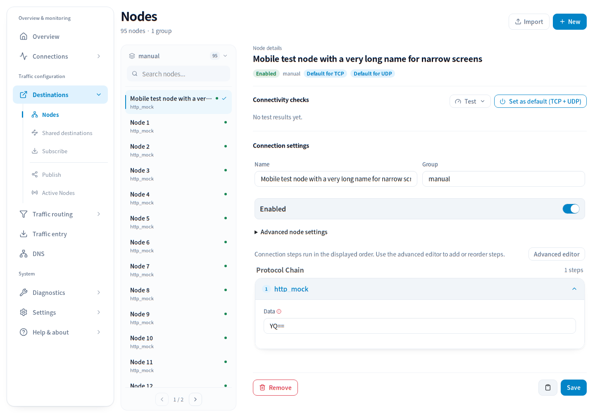
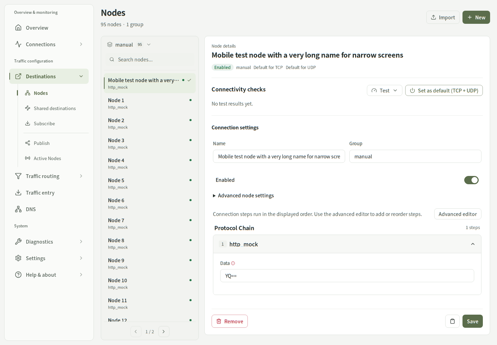
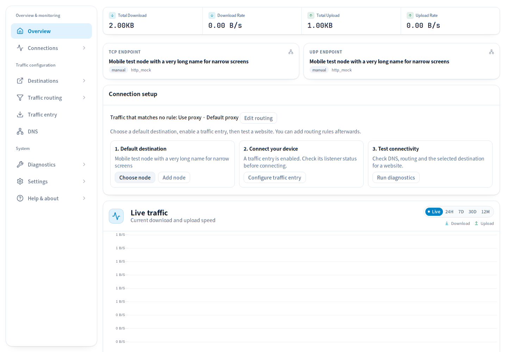
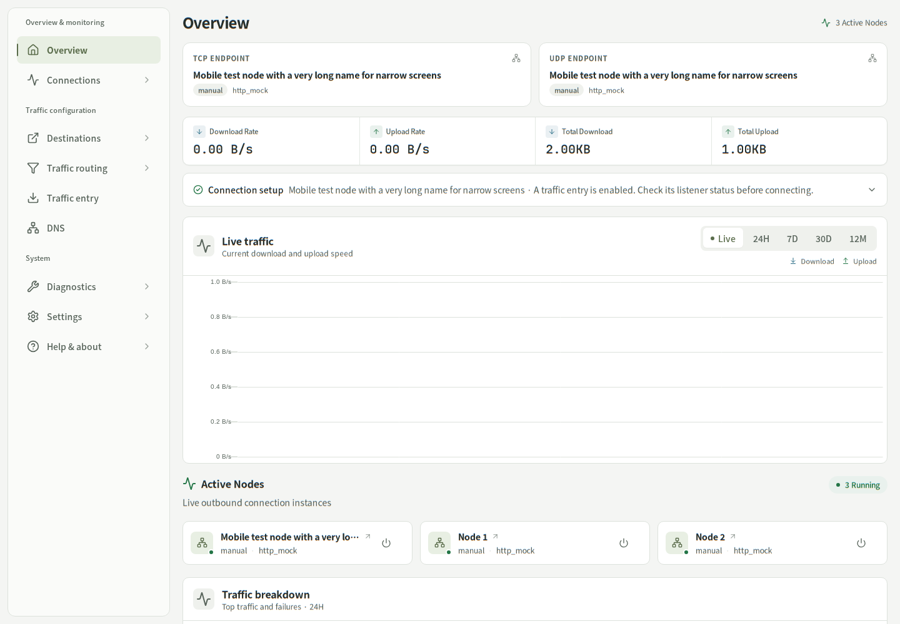
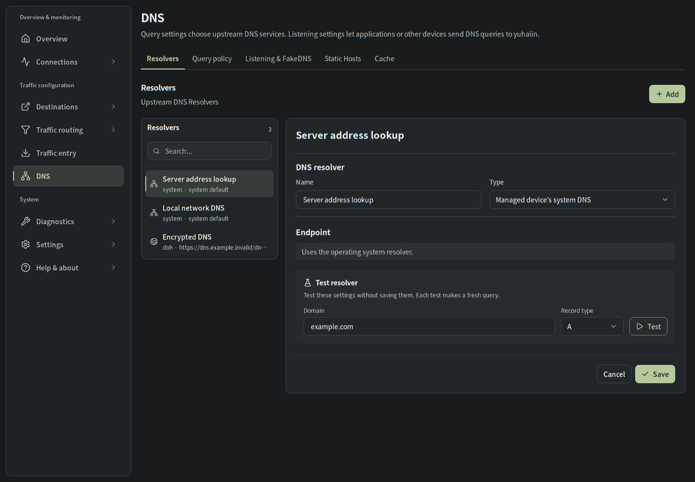
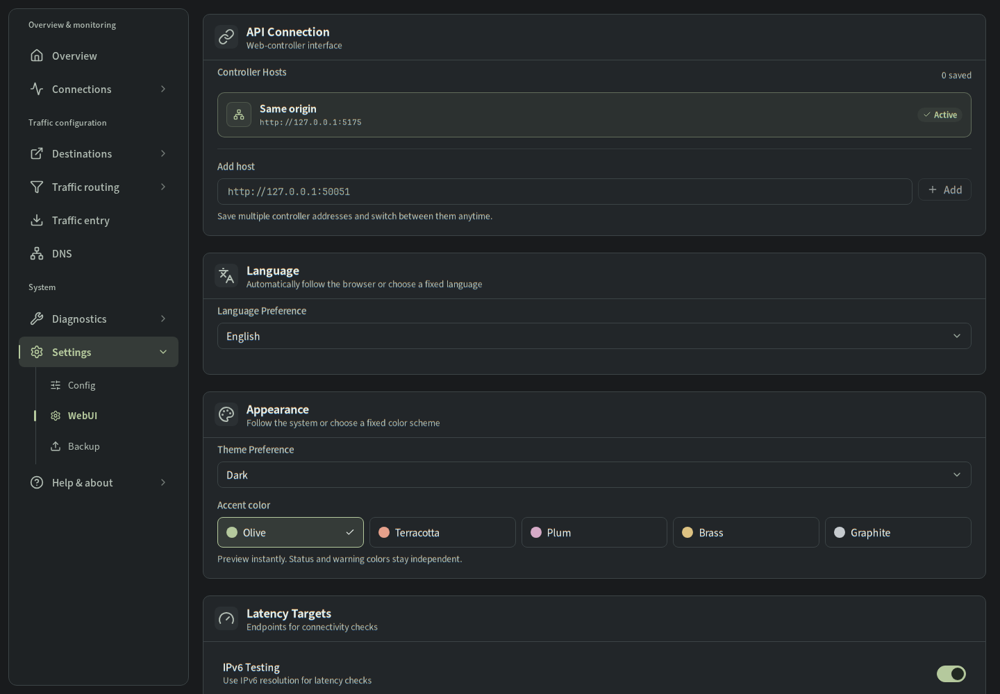
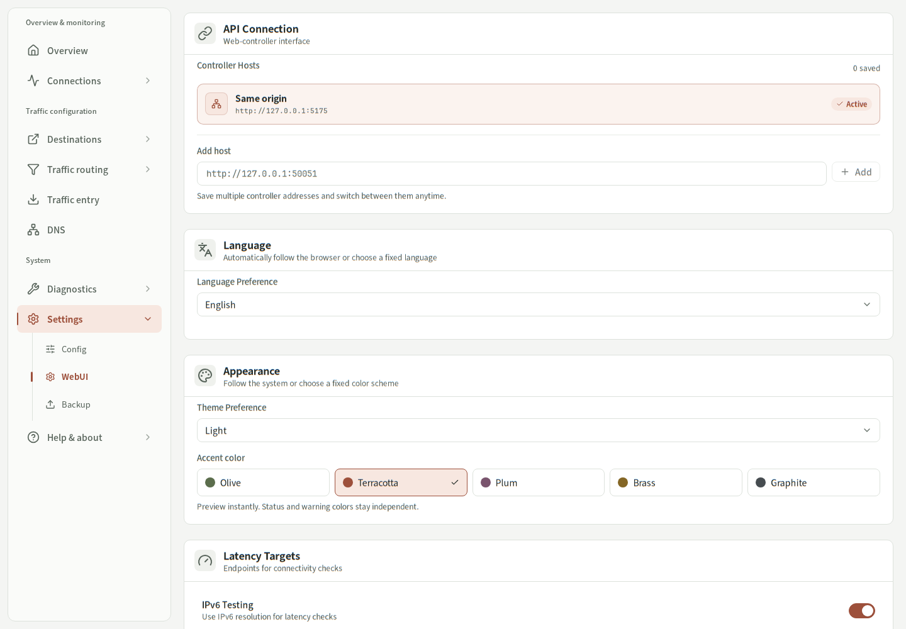
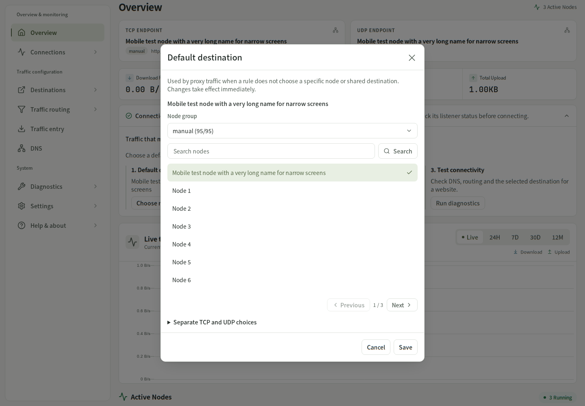
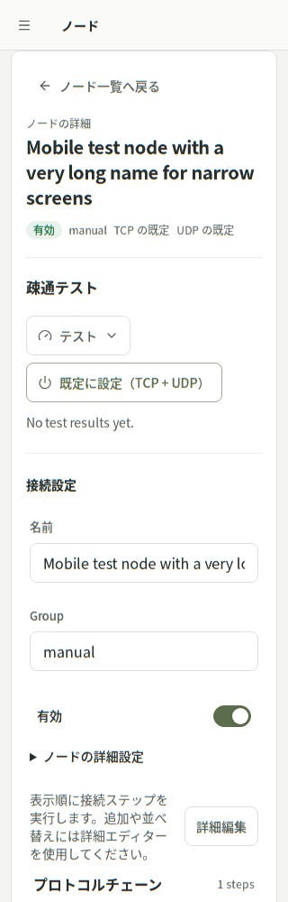

# Visual system

See the [second-pass component refinement and Gallery](refinement/README.md) for current validation, root-cause findings and screenshots.

Implemented on `codex/visual-system`, starting from main `4c67ae0`. Screenshots use synthetic, local MSW data, not a live controller.

## Surfaces and hierarchy

Light mode separates a warm gray canvas, a quiet sidebar, muted directories and white editing surfaces. Dark mode uses graphite surfaces with distinct canvas, muted and raised levels. Moderate radii, quiet dividers and smaller headings replace repeated shadows and excessive nested panels.

The existing directory/detail structure stays intact. Shared resource rows use a 52px minimum on desktop, with longer routing summaries retaining their additional lines. The desktop directory remains 300px on wide screens; the detail surface has one consistent inset. Mobile keeps the existing directory/editor switching and at least 44px interactive targets. Native switches now have a 44px target around their compact visual track.

DNS identity, endpoint and test controls use sections instead of three nested bordered panels. Nodes still prioritize names, current usage, protocol chains and available test results; routing retains priority, conditions, destination and enabled state. Subscriptions, inbounds and shared destinations inherit the same directory/editor treatment.

## Independent mode and accent

The existing `yuhaiin.theme` preference (`light`, `dark`, `system`) is preserved. The new `yuhaiin.accent` preference drives `data-accent` independently of `data-bs-theme`. Missing or invalid accent settings fall back to Olive. The HTML bootstrap applies both before React starts, including a system-mode fallback when storage is blocked.

| Accent | Light | Dark | Light soft surface |
| --- | --- | --- | --- |
| Olive | `#5B6D4C` | `#B5C99D` | `#E8EFE3` |
| Terracotta | `#9D503B` | `#E6A18C` | `#F7E7E0` |
| Plum | `#79546D` | `#D5AAC7` | `#F2E7EE` |
| Brass | `#846625` | `#DDC282` | `#F5EEDC` |
| Graphite | `#464C50` | `#C6CBCF` | `#E9EBED` |

Olive and Terracotta were darkened slightly from the brief to pass normal text contrast on their soft selected backgrounds. Dark accents use dark foreground text. Dark soft surfaces and hover/pressed colors are derived with `color-mix`, rather than repeated per-page hex values. Status, warning, error and chart-series colors remain independent of the selected accent.

WebUI → Appearance provides labeled swatches, immediate preview, persistent selection and arrow/Home/End keyboard navigation. Quick key presses select synchronously so focus and selection cannot diverge during Radix's deferred focus update.

## Shared controls and feedback

Buttons have distinct hover and pressed backgrounds, 0.98 press feedback, solid accent focus indicators and reduced-motion support. The new native-button `loading` state reserves its original label width, announces busy state and disables repeat clicks; resolver/shared-destination saves use it. Secondary and destructive outlines retain quiet surfaces and their own semantic colors.

Inputs/textareas use surface backgrounds, stronger hover borders, a soft focus halo with a solid accent border, explicit invalid states and separate readonly/disabled treatments. Select, dropdown and combobox popovers have restrained radii and shadows; selected options and keyboard highlights have distinct cues. Switches, native checkboxes/radios and sliders follow the accent. Ordinary badges default to neutral styling, while explicitly semantic badges keep their status colors.

Sidebar groups, selected indicators, tabs, pagination and directory selection follow the same palette. Page transitions move only a few pixels; dialogs fade with a small vertical offset, and tooltips/toasts no longer zoom dramatically. Existing Motion and reduced-motion support are retained.

## Overview

The overview puts an existing active-node count and TCP/UDP selections before rates and totals. The setup guide collapses only when the selected-node response contains both defaults and the inbound response contains an enabled entry. It is a configuration summary, not a claim that connectivity has been tested. Missing data or missing configuration keeps guidance visible; configure and diagnostic actions remain available when expanded.

The live chart is shorter, with download/upload colors shared with the corresponding semantic labels. Compact active-node tiles precede detailed traffic breakdowns. The home wrapper uses natural minimum height so the route scroller's bottom padding remains visible. Existing APIs, data sources, pagination, lazy loading, draft protection and destructive confirmations are retained; no backend changes or dependencies were added.

## Before / after

| Main baseline | Updated |
| --- | --- |
|  |  |
|  |  |

| Graphite dark DNS | Appearance |
| --- | --- |
|  |  |

| Terracotta light | Node picker | Japanese mobile editor (320px) |
| --- | --- | --- |
|  |  |  |

The existing `docs/ux-refactor` snapshots were also refreshed for all 18 directory/editor states.

## Validation

- 154 unit/component tests across 62 files, including mode/accent persistence, storage failures, bootstrap initialization, keyboard selection, button busy state and reliable setup-guide conditions.
- TypeScript, lint, i18n checks for all three supported languages, style audit, production build, workflow actionlint and `git diff --check`.
- `npm run visual:check`: 104 real Chromium page states covering Overview, Nodes, Routing, DNS, Connections, Subscriptions, Inbounds and WebUI at 1440px/390px/320px in both modes, plus all five accents in both modes. Checks initialization, horizontal overflow, clipped visible form controls and computed token contrast. The minimum checked text-pair ratio is 4.538:1; focus/control-border token pairs meet 3:1. Results are saved in [contrast-results.json](contrast-results.json).
- Existing MSW capture script: 18 desktop/mobile directory and editor states, including the advanced rule editor and node details.
- Additional Chromium interactions: mouse and keyboard swatch selection, reload persistence, OS theme changes, hover/press feedback, switch toggling, dropdown dismissal, unsaved-edit cancellation, configured-guide expansion and node-selection dialog. No page exceptions. The loading-button check measured the same 216.6875px width before and during loading. Home bottom spacing checked at 1440px, 390px and 320px; Japanese node-editor layout checked at 390px and 320px.
- CI runs the visual matrix and uploads its screenshots and results as the `visual-system` artifact.

## Remaining refinements

Contrast checks validate the shared palette pairs, not a full automated accessibility audit of every legacy page. Some existing copy still lacks complete Japanese/Korean translation, and a few older advanced forms retain their own layout conventions. Native Safari/Firefox and a real device keyboard were not available for this run; actual browser verification used Chromium. The changes use the existing modern Tailwind/Radix/Motion stack and standard CSS rather than a new UI framework.
